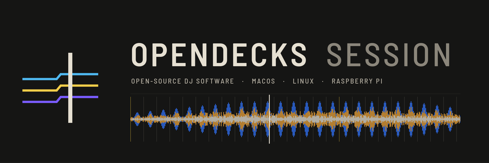

<p align="center"></p>

<p align="center">
  <a href="https://github.com/nurkert/opendecks-session/actions/workflows/ci.yml"></a>
  <a href="https://github.com/nurkert/opendecks-session/actions/workflows/release.yml"></a>
  <a href="https://github.com/nurkert/opendecks-session/releases"></a>
  <a href="https://github.com/nurkert/opendecks-session/releases"></a>
  <a href="LICENSE"></a>
  
  
  <a href="https://github.com/nurkert/opendecks-session/commits/main"></a>
</p>

<p align="center">
  <a href="https://github.com/nurkert/opendecks-session/releases/latest">Download</a> ·
  <a href="docs/SPEC.md">Specification</a> ·
  <a href="docs/feature-matrix.md">Feature parity</a> ·
  <a href="docs/keyboard.md">Keyboard shortcuts</a> ·
  <a href="docs/parity.md">Verification</a>
</p>

# OpenDecks Session

Open-source DJ software in Rust for macOS, Linux and the Raspberry Pi.
Prepare your library and sets, keep USB sticks in sync automatically, and
perform with compatible DJ controllers (for example the Pioneer DJ DDJ-FLX10
and DDJ-FLX4) — on your laptop or as a standalone unit built from a Raspberry
Pi and your controller. See [docs/SPEC.md](docs/SPEC.md) for the full
specification.

## What it does

- **Library** — referenced music files, fast search, playlists, folders,
  smart playlists with a text rule syntax (`bpm 120-126, key 8A~, genre house`),
  undo/redo for every edit, automatic backups, relocation of moved files.
- **Analysis** — BPM and beatgrid with downbeats, key (Camelot, Open Key or
  musical), three-band waveforms, phrases, loudness; pure Rust, a 6-minute
  track in about 0.3 s on an M1.
- **Sets** — ordered set lists with the flow of tempo, key and energy,
  transition hints (good / caution / clash), transition notes and backups.
- **USB sticks that stay in sync** — register a stick once with the lists
  that belong on it. Every change to a playlist, cue or beatgrid is written
  to the stick automatically and incrementally while it is plugged in, with a
  visible state per stick and one-click eject. Each stick carries the Pioneer
  DJ export (`export.pdb` + ANLZ) for club players and the OpenDecks format
  for OpenDecks itself. Cues set on players and their history are read back
  and offered for review instead of being overwritten.
- **Prepare** — beatgrid editor with tap / typed BPM and tempo markers,
  phrase editor, cue editor (names, colours, saved and active loops), one
  or two players, a sub-browser for moving tracks between lists, an edit
  mode that cuts, trims or repeats a section into a new track, and stem
  separation ahead of time.
- **Perform** — 2 or 4 decks in standard, vertical-waveform or browse
  layouts, sync (beat or tempo only) and quantize, keylock (Rubber Band),
  hot and memory cues, loops, slip, beat jump, pad modes (hot cue, pad FX,
  beat jump / loop, sampler, keyboard, key shift, slicer, stems, memory cue,
  censor, sequence call, lighting), Beat FX with three-slot multi mode and
  Stem FX on a single part, colour FX incl. Smart CFX, Smart Fader, part
  isolation on the mixer, sampler with sequencer, vocal position from the
  separated parts, controller mappings for the DDJ-FLX10 and DDJ-FLX4 with
  LED feedback, microphone / aux input with talkover.
- **Club-player practice (CDJ mode)** — one switch turns each deck into a
  player-style screen with the players' cue rules, no on-screen sync, and a
  checklist that ticks itself off while you load, cue and beatmatch by ear,
  so a controller owner is ready for the booth.
- **Lighting** — a DMX light show that follows the music: an automatic mode
  that reads phrases, beat and energy and blends the looks of both tracks
  during a mix, an easy mode with looks and colours, and a pro mode with
  per-group programs, beat-synced effects, an XY programmer, a cue stack and
  lighting cues stored with each track. Moving heads, LED bars, PARs,
  strobes, blinders, lasers and fog (built-in or Open Fixture Library
  files), Art-Net, sACN and USB-DMX interfaces, a live stage preview in its
  own tab, inside Perform or in a window on a second screen, and every
  control mappable to MIDI.
- **Recording** — one button; WAV, FLAC or MP3 with an automatic tracklist
  as `.cue` and as text for Mixcloud/SoundCloud, optional split into one
  file per track.
- **Exchange** — rekordbox-compatible XML export and import for other DJ
  applications, a whole-library archive (`.odlib`) for moving to a new
  computer, and a duplicate finder.
- **One-time rekordbox migration** — tracks, cues, beatgrids, keys and
  playlists from your rekordbox library or a rekordbox USB stick. rekordbox
  data is only read from a temporary copy, never changed, and never accessed
  again afterwards.
- **Raspberry Pi standalone** — boots straight into Perform, plays sticks
  prepared on your Mac, controlled entirely from the controller.
- English and German interface; colour-blind-safe state display (state is
  carried by line form, not only by colour).

## Build

Requirements: Rust (stable), Rubber Band, pkg-config.

```sh
# macOS
brew install rubberband pkg-config
# Debian / Ubuntu / Raspberry Pi OS (64-bit)
packaging/linux/install-build-deps.sh

cargo build --release -p opendecks -p od-cli
./target/release/opendecks            # the app
./target/release/opendecks --lang de  # German interface
```

Options: `--library <path>`, `--profile lite|full`, `--kiosk`,
`--scale <factor>`, `--lang en|de`, `--keys camelot|openkey|musical`,
`--colorblind`, `--high-contrast`, `--no-motion`, `--window WxH`.

Packages: `packaging/macos/build-dmg.sh` (.app/.dmg),
`packaging/linux/build-appimage.sh` (AppImage),
`packaging/linux/org.opendecks.Session.yml` (Flatpak),
`packaging/raspberry-pi/` (kiosk bundle, installer and SD-image stage — see
its README).

## First steps

1. **Add music** (or **Import from rekordbox** once).
2. Analysis runs in the background; the status band shows progress.
3. Create playlists and sets; select tracks and press **+** next to a list in
   the sidebar to add them. Click a list's title to rename it.
4. Plug in a USB stick, select the list or folder that should go on it and
   press **Register with …** on the device board. From then on the stick
   follows every change.
5. Switch to **Perform**, double-click a track (or press the browse encoder)
   to load it on a free deck.

Keyboard: ⌘Z / ⌘⇧Z undo/redo, ↑/↓ select, Space preview, 1–8 hot cues,
Delete removes from the list.

## Headless tool

`od-cli` drives the same crates without a window:

```sh
od-cli import ~/Music/House
od-cli analyze
od-cli playlist "Warmup" --search deep
od-cli register /Volumes/STICK --playlist Warmup
od-cli sync /Volumes/STICK
od-cli verify /Volumes/STICK
od-cli lighting add "Spot L" moving-head --group Movers
od-cli lighting output 0 --artnet 2.0.0.10:6454
od-cli lighting test --seconds 60     # simulated track: intro, build, drop …
```

## Architecture

| Crate | Purpose |
|---|---|
| `od-core` | Domain types: beatgrids, cues, keys, waveforms, phrases |
| `od-decode` | Decoding, tags, resampling (symphonia) |
| `od-analysis` | BPM/grid, key, waveform, phrases, loudness |
| `od-library` | SQLite library, undo journal, devices, backups |
| `od-format-pioneer` | `export.pdb` and ANLZ reader/writer |
| `od-format-native` | OpenDecks stick format |
| `od-devices` | Volume detection, incremental sync, background manager |
| `od-import-rekordbox` | One-time migration |
| `od-engine` | Real-time engine: decks, mixer, FX, sampler, record tap |
| `od-audio-io` | CoreAudio / ALSA / JACK / PipeWire output |
| `od-controller` | MIDI, mappings (`mappings/`), LED feedback |
| `od-recorder` | Recording and tracklists |
| `od-i18n` | Translations of messages produced in Rust |
| `od-ui` | Slint interface |
| `apps/opendecks`, `apps/od-cli` | Executables |

Design: [PRODUCT.md](PRODUCT.md) and [DESIGN.md](DESIGN.md).
Controller mapping format: [docs/controller-mappings.md](docs/controller-mappings.md).

## Status and open items

See [docs/verification.md](docs/verification.md) for what is verified (including a one-hour
four-deck soak without dropouts and sync to FAT32/exFAT sticks) and what needs hardware.


- Real CDJ/XDJ testing of the Pioneer export is still pending (validated
  byte-for-byte against rekordbox output where available and with independent
  parsers: rekordcrate, pyrekordbox).
- Controller mappings follow the published MIDI messages; entries marked
  `verify` in the mapping files need checking on real hardware (the DDJ-FLX4's
  USB IDs are still unknown). `cargo run -p od-controller --example
  midi_monitor` helps with that.
- Vendor USB settings and jog displays of the DDJ-FLX10 (milestone M4) need a
  USB capture with the controller connected.
- OneLibrary (`exportLibrary.db`) and LAN sync are planned for M5.
- The DDJ-FLX10's own DMX port, its jog displays and the assignment of its
  part buttons need the same USB capture (milestone M4); until then the
  lighting runs through Art-Net, sACN or a USB-DMX interface.
- `exportExt.pdb` (My Tag on players) is only partly documented publicly and
  waits for a player to verify against (milestone M6).

## Trademarks and independence

OpenDecks Session is an independent open-source project. It is not
affiliated with, endorsed by or sponsored by AlphaTheta Corporation, Pioneer
DJ or any other DJ hardware or software vendor, and it contains no code,
assets or designs of theirs. rekordbox, Pioneer DJ, CDJ, XDJ and DDJ are
trademarks of their respective owners and are used here only to describe
compatibility: importing an existing rekordbox library once, writing USB
sticks that compatible players can read, and supporting compatible
controllers.

## License

GPL-3.0-or-later. See [LICENSE](LICENSE). The bundled Barlow Semi Condensed
font is licensed under the SIL Open Font License (`crates/od-ui/fonts/OFL.txt`).
